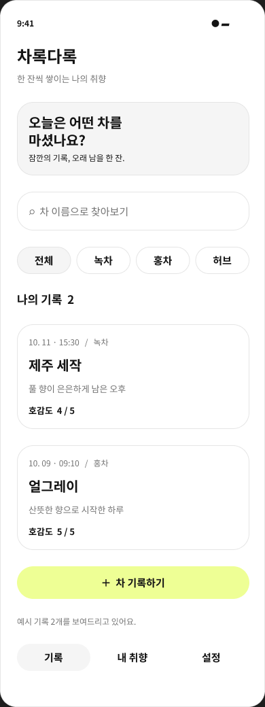
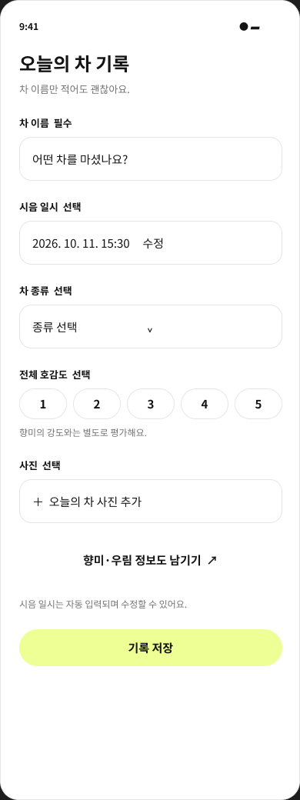
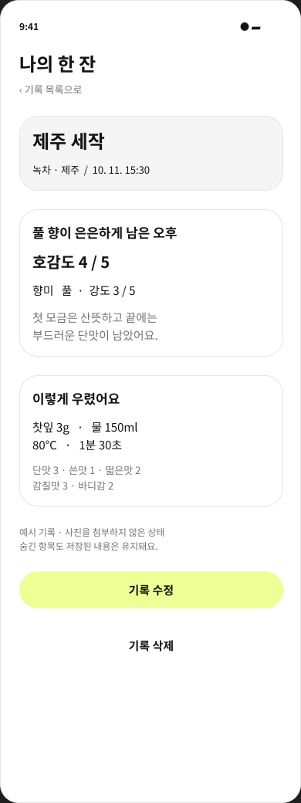
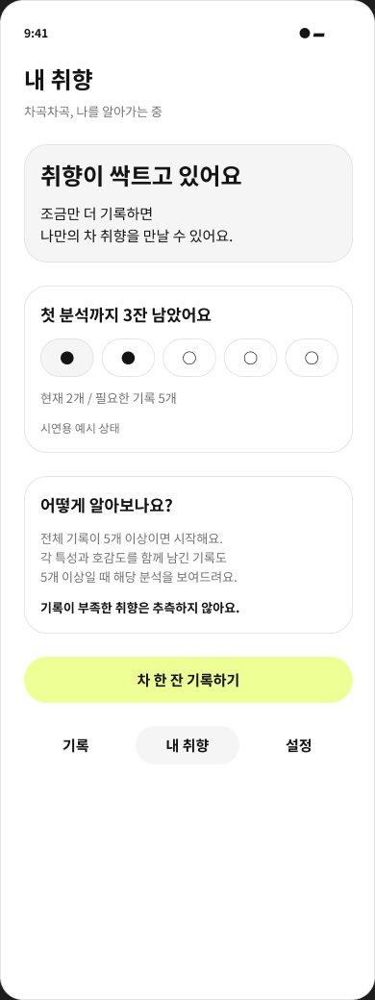
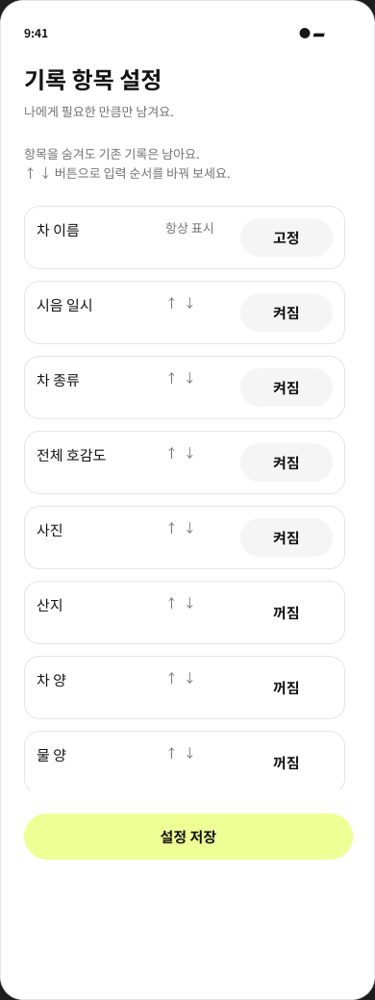

# 화면 검토 자료

UI Bowl 라운드의 카드 등록·검색 화면 2종만 참고했습니다. 넓은 라임색 배경과 장식 그림을 제거하고, 흰색·회색 UI와 화면별 주요 버튼의 #EEFF95로 정리했습니다. Noto Sans KR 대체 서체를 유지했습니다.

사람 검토: 브랜드색의 절제와 무채색 구성 / 참고 스타일과의 부합 / 시각적 가독성.

편집 가능한 정적 화면입니다. 저장 동작과 화면 이동은 구현 검증 대상입니다.

## record-list

[Figma 화면](https://www.figma.com/design/NEgBtr6qQA7oXLyE4bdFRq?node-id=38-379)

## record-create

[Figma 화면](https://www.figma.com/design/NEgBtr6qQA7oXLyE4bdFRq?node-id=38-426)

## record-detail

[Figma 화면](https://www.figma.com/design/NEgBtr6qQA7oXLyE4bdFRq?node-id=38-468)

## taste-analysis

[Figma 화면](https://www.figma.com/design/NEgBtr6qQA7oXLyE4bdFRq?node-id=38-495)

## field-settings

[Figma 화면](https://www.figma.com/design/NEgBtr6qQA7oXLyE4bdFRq?node-id=38-536)

